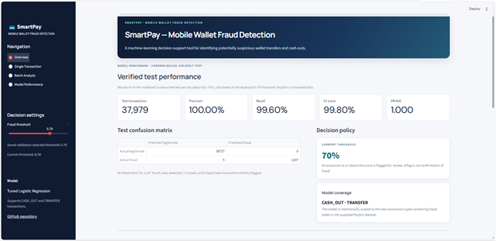
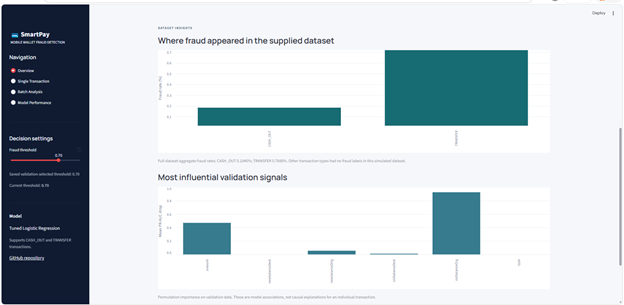
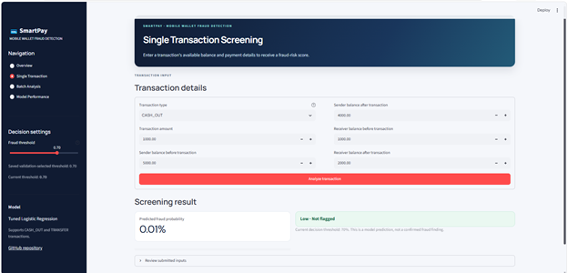
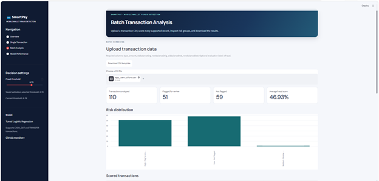
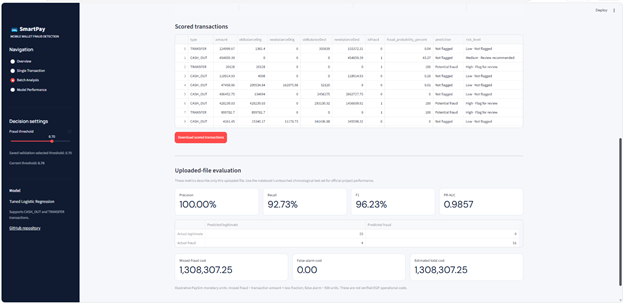
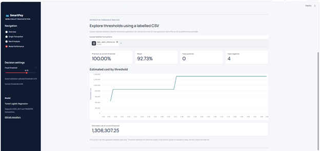

# SmartPay — Mobile Wallet Fraud Detection

SmartPay is a mobile-wallet fraud detection system built as an end-to-end machine-learning project. It scores supported transactions for potential fraud and provides a deployed Streamlit application for single-transaction screening, batch analysis, and model-performance exploration.

**Live application:** https://mobile-wallet-fraud-detection.streamlit.app/  
**GitHub repository:** https://github.com/Shahd-Salah/Mobile-Wallet-Fraud-Detection


## Project at a glance

| Item | Project details |
|---|---|
| Product name | SmartPay |
| Application description | Mobile Wallet Fraud Detection System |
| Business problem | Mobile-wallet fraud detection |
| Machine-learning task | Imbalanced binary classification |
| Target | `isFraud` (`1` = fraud, `0` = legitimate) |
| Dataset | PaySim simulated mobile-money transactions (Kaggle) |
| Full dataset audited | 6,362,620 rows × 11 columns |
| Fraud labels in full dataset | 8,213 (0.1291%) |
| Modelled transaction types | `CASH_OUT` and `TRANSFER` |
| Final saved model | Tuned Logistic Regression |
| Best tuning parameter | `C = 10.0` |
| Saved decision threshold | `0.70` |
| Application | Streamlit Community Cloud |

## 1. Business problem

Mobile-wallet providers need to identify suspicious transfers and cash-outs while avoiding unnecessary disruption to legitimate customers. The model returns a fraud probability that can help a fraud-operations team prioritize transactions for review.

The two main error types have different business effects:

- **False negative:** a fraudulent transaction is not flagged, potentially allowing financial loss and customer harm.
- **False positive:** a legitimate transaction is flagged, creating friction, support work, and possible customer dissatisfaction.

Because the positive class is rare, accuracy alone is not a useful primary metric. The notebook emphasizes **Average Precision / PR-AUC**, recall, precision, F1, ROC-AUC, confusion-matrix analysis, and estimated error cost.

## 2. Dataset and source

The dataset file used in the local project was `fraud data.csv`. The project brief identifies the source as the **PaySim Mobile Money Simulation** dataset on Kaggle:

- Dataset page: https://www.kaggle.com/datasets/ealaxi/paysim1
- Dataset nature: simulated mobile-money transactions. It was designed to reproduce patterns from mobile-money operations while avoiding disclosure of real customer transaction records.

The full file audit found **6,362,620 rows and 11 columns**, with no missing values in the audited columns. The target distribution was:

| Target | Transactions | Share |
|---|---:|---:|
| Legitimate (`isFraud = 0`) | 6,354,407 | 99.8709% |
| Fraudulent (`isFraud = 1`) | 8,213 | 0.1291% |
| **Total** | **6,362,620** | **100%** |

The amount field's currency denomination was not established by the supplied notebook/audit. Amount and cost figures below are therefore described in **dataset monetary units**, not asserted to be EGP.

### Transaction types

All 8,213 fraud labels in the full-file audit occurred in `CASH_OUT` and `TRANSFER` transactions:

| Transaction type | Total rows | Fraud rows | Fraud rate within type |
|---|---:|---:|---:|
| `CASH_OUT` | 2,237,500 | 4,116 | 0.1840% |
| `TRANSFER` | 532,909 | 4,097 | 0.7688% |
| `CASH_IN` | 1,399,284 | 0 | 0.0000% |
| `PAYMENT` | 2,151,495 | 0 | 0.0000% |
| `DEBIT` | 41,432 | 0 | 0.0000% |

The modelling and app scope was therefore restricted to `CASH_OUT` and `TRANSFER`. This is a property of this simulated dataset; it should not be assumed to describe every real wallet provider's fraud patterns.

## 3. Data split and sampling strategy

The notebook uses a **chronological split on `step`**, not a stratified random split:

| Period | Step range | Full-file rows | In-scope rows (`CASH_OUT` / `TRANSFER`) | In-scope frauds | In-scope fraud prevalence |
|---|---:|---:|---:|---:|---:|
| Train | 1–520 | 6,082,007 | 2,653,729 | 5,781 | 0.2178% |
| Validation | 521–631 | 191,147 | 78,701 | 1,180 | 1.4993% |
| Test | 632–743 | 89,466 | 37,979 | 1,252 | 3.2966% |

The step boundaries were approximately 70% / 15% / 15% of the **time axis**. Because transactions are not evenly distributed over `step`, the resulting row counts are not 70% / 15% / 15%. The validation and test periods kept their natural class prevalence and were not resampled.

To make model comparison practical, the final training workflow used a training-only sample reported by the executed notebook cell as **305,781 rows: all 5,781 training frauds plus 300,000 randomly sampled legitimate transactions**. The final Logistic Regression used `class_weight="balanced"`; the saved `ResampledClassifier` artifact reports `strategy = "none"` (no additional under/oversampling in that saved wrapper). No validation or test observations were included in the training sample.

> **Notebook consistency note:** One later markdown summary in the notebook says 50,000 legitimate rows, while the executed training-cell output records 300,000 legitimate rows and 305,781 total. The README uses the executed cell output. Correct that conflicting markdown sentence in the notebook before final submission.

## 4. Exploratory data analysis — measured findings

The following findings are supported by the supplied full-file audit and notebook outputs:

1. **Extreme class imbalance:** only 8,213 of 6,362,620 transactions were labelled fraud (0.1291%). This is why accuracy was not selected as the main metric.
2. **Fraud concentration by transaction type:** all labelled frauds in the full file were `CASH_OUT` (4,116) or `TRANSFER` (4,097). Within-type fraud rates were 0.1840% and 0.7688%, respectively.
3. **Amount difference:** the full-file mean transaction amount was 1,467,967.30 for fraud and 178,197.04 for legitimate transactions (about 8.24× higher for the fraud-labelled group). This is a descriptive association, not evidence that amount alone causes fraud.
4. **A strong balance signal:** on the training sample, the engineered `orig_drained` feature achieved single-feature Average Precision of 0.9784. This is unusually strong and is a reminder that PaySim's simulated balance mechanics are highly informative.
5. **Engineered features helped on validation:** the Logistic Regression validation PR-AUC was 1.0000 with the engineered feature pipeline versus 0.8719 using raw columns only in the reported comparison.

### Validation permutation importance

Permutation importance was measured on validation data using Average Precision. The reported mean PR-AUC drops were:

| Input feature | Mean PR-AUC drop | Standard deviation |
|---|---:|---:|
| `oldbalanceOrg` | 0.9271 | 0.0042 |
| `amount` | 0.4710 | 0.0055 |
| `newbalanceOrig` | 0.0553 | 0.0007 |
| `oldbalanceDest` | 0.0108 | 0.0007 |
| `newbalanceDest` | 0.0002 | 0.0000 |
| `type` | 0.0000 | 0.0000 |

These values show how much validation Average Precision changed when one input column was shuffled. They describe predictive reliance in this dataset, not causal effects.

## 5. Features and preprocessing

The deployed model accepts six raw input columns:

| Column | Meaning |
|---|---|
| `type` | Transaction type (`CASH_OUT` or `TRANSFER`) |
| `amount` | Transaction amount |
| `oldbalanceOrg` | Sender balance before the transaction |
| `newbalanceOrig` | Sender balance after the transaction |
| `oldbalanceDest` | Receiver balance before the transaction |
| `newbalanceDest` | Receiver balance after the transaction |

The target `isFraud`, account identifiers (`nameOrig`, `nameDest`), and `isFlaggedFraud` are not model inputs. The shared `fraud_features.py` module creates balance-derived features, including:

- `delta_orig` and `delta_dest` — sender/receiver balance movements.
- `err_orig` and `err_dest` — balance-reconciliation differences.
- `amount_to_old_orig` — transaction amount relative to the sender's previous balance.
- `orig_drained`, `orig_emptied`, and `dest_empty` — balance-state indicators.

The preprocessing pipeline includes median imputation, signed `log1p` transformation, scaling where configured, and one-hot encoding for transaction type. The preprocessing is part of the saved fitted pipeline so the Streamlit application uses the same transformations as model development.

## 6. Class-imbalance strategies

Five training strategies were compared using validation Average Precision:

| Strategy | Validation PR-AUC | Rows used to fit | Fraud rows used to fit |
|---|---:|---:|---:|
| No handling | 0.9979 | 305,781 | 5,781 |
| Class weights | 1.0000 | 305,781 | 5,781 |
| Undersample 1:10 | 0.9982 | 63,591 | 5,781 |
| Undersample 1:1 | 0.9992 | 11,562 | 5,781 |
| Oversample 1:10 | 0.9982 | 330,000 | 30,000 |

Class weighting was selected because it was within 0.002 of the best validation PR-AUC while retaining the training sample. Sampling was applied only within the training/model-fitting workflow; validation and test data retained natural prevalence.

## 7. Model comparison and hyperparameter tuning

The notebook compared a Dummy prior baseline, a simple `orig_drained` rule, and four classifiers. The following table reports **validation results at a probability threshold of 0.50**. These are not final test scores.

| Candidate | PR-AUC / AP | ROC-AUC | Precision @ 0.50 | Recall @ 0.50 | F1 @ 0.50 |
|---|---:|---:|---:|---:|---:|
| Dummy prior baseline | 0.0150 | 0.5000 | 0.0000 | 0.0000 | 0.0000 |
| Rule: `orig_drained` | 0.9841 | 0.9919 | 1.0000 | 0.9839 | 0.9919 |
| Logistic Regression | 1.0000 | 1.0000 | 0.9992 | 0.9983 | 0.9987 |
| Decision Tree | 0.9999 | 1.0000 | 1.0000 | 0.9975 | 0.9987 |
| Random Forest | 1.0000 | 1.0000 | 1.0000 | 1.0000 | 1.0000 |
| HistGradientBoosting | 1.0000 | 1.0000 | 0.9992 | 1.0000 | 0.9996 |

The persisted final model is **Tuned Logistic Regression**. It was tuned with `GridSearchCV` over `C = [0.1, 1.0, 10.0]`, using `average_precision` as the scoring metric and three expanding time-window folds built only from the training sample. The best setting was **`C = 10.0`**, with best cross-validation Average Precision **0.9987**.

The notebook's validation result for the tuned Logistic Regression was PR-AUC 1.0000, ROC-AUC 1.0000, precision 0.9992, recall 0.9983, and F1 0.9987 at threshold 0.50. Tree ensembles also performed extremely strongly on this simulated validation period. Logistic Regression was retained as the final saved model, providing a comparatively straightforward, explainable classifier with strong validation and CV performance; it should not be described as uniquely superior on every validation metric.

## 8. Final evaluation on the chronological test period

The final model was evaluated on the untouched modelling test period: **37,979 in-scope transactions, including 1,252 frauds and 36,727 legitimate transactions** (3.2966% fraud prevalence).

### Notebook's explicitly printed result at threshold 0.50

| Metric | Result |
|---|---:|
| True positives | 1,248 |
| False positives | 0 |
| True negatives | 36,727 |
| False negatives | 4 |
| Precision | 1.0000 |
| Recall | 0.9968 |
| F1-score | 0.9984 |
| False-positive rate | 0.0000 |
| False-negative rate | 0.0032 |
| ROC-AUC | 1.0000 |
| PR-AUC / Average Precision | 1.0000 |

### Results at the saved application threshold of 0.70

The notebook's test-cost output reports **5 missed frauds and 0 false alarms** at the saved 0.70 threshold. Given 1,252 actual test frauds and 36,727 legitimate cases, the corresponding threshold-specific confusion counts are TP = 1,247, FP = 0, TN = 36,727, FN = 5. From these counts, precision is 1.0000, recall is 0.9960, and F1 is 0.9980. ROC-AUC and PR-AUC are threshold-independent and remain 1.0000 from the reported test score calculations.

> **Verification:** The 0.70 results above were recalculated directly in the notebook using `test_predictions = (p_test >= 0.70).astype(int)` and the untouched test labels. They match the saved application threshold.

## 9. Cost-based threshold selection

The threshold was selected using **validation data only** (steps 521–631), not by tuning on the final test set. The notebook swept candidate thresholds and estimated:

- Missed-fraud cost = the full transaction amount (loss fraction = 1.0).
- False-alarm cost = 500 dataset monetary units per false positive.

These are **illustrative assumptions**, not independently verified real-world losses, and the amount currency was not identified as EGP. On validation data, the minimum estimated cost was 0 across a near-optimal threshold range of 0.50–0.90. The midpoint of that range, **0.70**, was saved in the model artifact.

| Validation policy | Estimated cost (dataset monetary units) |
|---|---:|
| Flag nothing | 1,497,276,960 |
| Flag everything | 38,760,500 |
| Minimum across near-optimal range | 0 |
| Selected threshold | 0.70 (midpoint of 0.50–0.90 range) |

### Held-out test cost comparison

| Test policy | Estimated cost | Missed frauds | False alarms |
|---|---:|---:|---:|
| Saved validation-selected threshold (0.70) | 10,000,000 | 5 | 0 |
| Default threshold (0.50) | 0 | 4 | 0 |
| Flag nothing | 2,130,128,675.21 | 1,252 | 0 |
| Flag everything | 18,363,500 | 0 | 36,727 |

The 0.50 test cost is zero because the four missed frauds at that threshold had zero transaction amounts in the notebook's missed-fraud listing. This does **not** mean those cases have no customer, reputational, or operational cost. The test comparison also shows that the 0.70 validation-selected threshold did not reproduce the validation cost plateau perfectly on the later test period. Do not change the threshold after seeing test results and then present that test set as untouched; any revised threshold must be selected on a new validation period.

## 10. Streamlit application

The deployed **SmartPay** application has four navigation pages:

1. **Overview** — verified test-set benchmark, dataset fraud patterns, and validation permutation-importance signals.
2. **Single Transaction** — enter the six input fields, calculate fraud probability, and receive a review recommendation based on the selected threshold.
3. **Batch Analysis** — download the expected CSV template, upload multiple transactions, inspect risk groups and row-level predictions, and download results. Labelled uploads also show evaluation metrics and the illustrative cost breakdown.
4. **Model Performance** — review the confirmed chronological test benchmark and explore threshold-versus-cost behavior using a labelled CSV. Threshold selection for the final project remains validation-only.

Additional dataset, methodology, cost-assumption, and responsible-use information is available in the **Project information & responsible use** expander on the Overview page.

Only the six model input fields are required for prediction. `isFraud` is required only for labelled evaluation. The 20-row CSV created during app testing was used to check the interface and batch-prediction workflow; it is not the source of the final test metrics reported above.


## Application Screenshots

### 1. Overview Dashboard

<p align="center">
  
  
</p>

### 2. Single Transaction Analysis

<p align="center">
  
</p>

### 3. Batch Analysis

<p align="center">
  
  
</p>

### 4. Model Performance

<p align="center">
  
</p>


## 11. Repository structure

```text
Mobile-Wallet-Fraud-Detection/
├── App.py
├── fraud_features.py
├── fraud_pipeline.joblib
├── Mobile_Wallet_Fraud_Detection.ipynb
├── home.png
├── single_transaction.png
├── csv_upload.png
├── fraud_dashboard.png
├── requirements.txt
├── README.md
└── .gitignore
```

The serialized model depends on the custom `fraud_features.py` module. Keep both files in the repository root and together when running locally or deploying. The application entry file is `App.py` (capital A; filenames are case-sensitive on Linux).

## 12. Run locally

Use Python 3.13 and create a virtual environment:

```bash
python -m venv .venv
```

Windows PowerShell activation:

```powershell
.\.venv\Scripts\Activate.ps1
```

Install the pinned dependencies:

```bash
python -m pip install -r requirements.txt
```

Run the app:

```bash
python -m streamlit run App.py
```

Open the local URL displayed in the terminal.

## 13. Limitations and responsible use

- **Synthetic data:** PaySim is simulated. The high validation/test scores should not be interpreted as expected performance on live wallet traffic.
- **Temporal distribution shift:** Within the modelled transaction types, fraud prevalence rises from 0.2178% in the training period to 1.4993% in validation and 3.2966% in test. This makes temporal monitoring and recalibration important.
- **Post-transaction fields:** The model uses `newbalanceOrig` and `newbalanceDest`. Their availability at the precise pre-authorization decision time must be verified before real-time deployment.
- **Narrow scope:** Only `CASH_OUT` and `TRANSFER` are supported; other transaction types are rejected/not modelled.
- **Limited feature set:** Device, location, account history, behavioural, network, and customer-level context are not included.
- **Illustrative costs:** Cost assumptions are not verified business loss estimates and are not confirmed as EGP.
- **Threshold sensitivity:** The 0.70 threshold was selected on validation; test-set costs differed from the validation cost plateau.
- **Human review:** A model score is not proof of fraud. Do not automatically block customer funds based solely on this academic prototype.
- **Training sample documentation:** The notebook summary was corrected to match the executed training output: 300,000 randomly sampled legitimate transactions plus all 5,781 training frauds (305,781 rows total).

## 14. References

- PaySim Mobile Money Simulation dataset, Kaggle: https://www.kaggle.com/datasets/ealaxi/paysim1
- NextGen Institute, *Machine Learning — Final Project Ideas*, Project 06: Mobile-Wallet Fraud Detection (course brief supplied for this project).

## Project deliverables

- Jupyter notebook: `Mobile_Wallet_Fraud_Detection.ipynb` (included in the GitHub repository).
- Saved model: `fraud_pipeline.joblib`.
- Custom feature module: `fraud_features.py`.
- Deployed Streamlit application: https://mobile-wallet-fraud-detection.streamlit.app/.
- Source repository: https://github.com/Shahd-Salah/Mobile-Wallet-Fraud-Detection.
