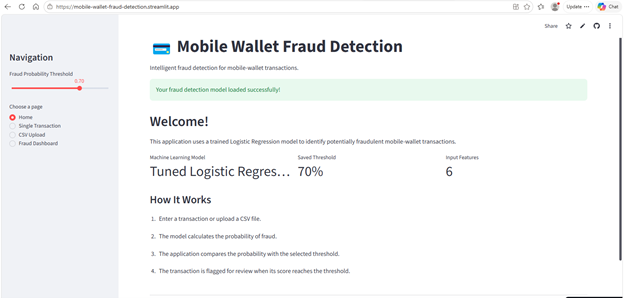
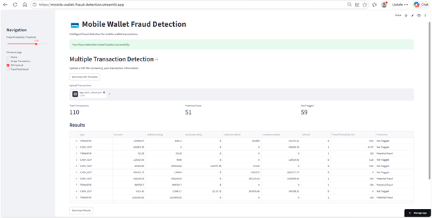
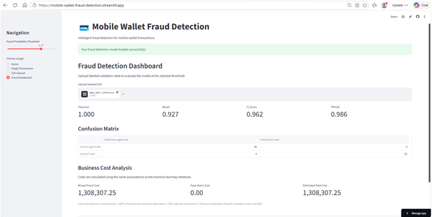

# Mobile Wallet Fraud Detection

An end-to-end machine learning project that identifies potentially fraudulent mobile-wallet transactions using Logistic Regression and a cost-sensitive classification threshold. The project includes exploratory data analysis, preprocessing, model comparison, hyperparameter tuning, evaluation, and a deployed Streamlit application.

**Live Application:** https://mobile-wallet-fraud-detection.streamlit.app/

**GitHub Repository:** https://github.com/Shahd-Salah/Mobile-Wallet-Fraud-Detection

---

## 1. Project Overview

### Business Problem

Mobile-wallet services are increasingly important in digital payments. As transaction volumes grow, fraudulent transfers and cash-outs create financial losses for customers and payment providers.

The objective of this project is to develop a machine learning model that identifies potentially fraudulent transactions while minimizing unnecessary flags against legitimate customers.

The model supports fraud-operations teams by generating a fraud probability score for each transaction. Transactions exceeding the selected threshold can be flagged for further review.

### Project Objectives

- Identify fraudulent mobile-wallet transactions.
- Analyze patterns associated with fraudulent transfers and cash-outs.
- Handle extreme class imbalance.
- Compare different classical machine learning algorithms.
- Optimize the classification threshold using illustrative business costs.
- Deploy the trained model through an interactive Streamlit application.

## 2. Dataset Description

**Dataset:** PaySim Mobile Money Simulation

**Source:** [Kaggle – PaySim Mobile Money Simulation](https://www.kaggle.com/datasets/ealaxi/paysim1)

The dataset contains simulated mobile-money transactions designed to represent financial transaction patterns while protecting real customer information.

### Dataset Statistics

| Description | Value |
|---|---:|
| Total transactions | 6,362,620 |
| Total columns | 11 |
| Fraudulent transactions | 8,213 |
| Legitimate transactions | 6,354,407 |
| Fraud prevalence | 0.1291% |
| Missing values | 0 |

### Target Variable

`isFraud`

- 1 = Fraudulent transaction
- 0 = Legitimate transaction

Fraudulent transactions represent approximately 0.1291% of the complete dataset, creating a highly imbalanced classification problem.

### Transaction Types

The dataset contains five transaction types:

- PAYMENT
- TRANSFER
- CASH_OUT
- CASH_IN
- DEBIT

The fraud labels in the dataset occur in TRANSFER and CASH_OUT transactions.

The project therefore focuses its fraud-classification model on these two transaction types.

## 3. Exploratory Data Analysis

EDA was conducted to understand the transaction distributions, fraud prevalence, transaction types, and balance patterns.

### Key Findings

**1. Extreme Class Imbalance**

Only 8,213 transactions out of 6,362,620 were fraudulent, representing approximately 0.1291% of the dataset. This makes accuracy alone an unsuitable performance metric.

**2. Fraud Concentration by Transaction Type**

Fraud was concentrated in CASH_OUT and TRANSFER transactions.

| Transaction Type | Fraud Count | Fraud Rate |
|---|---:|---:|
| CASH_OUT | 4,116 | 0.1840% |
| TRANSFER | 4,097 | 0.7688% |
| PAYMENT | 0 | 0% |
| CASH_IN | 0 | 0% |
| DEBIT | 0 | 0% |

**3. Transaction Amounts**

The average transaction amount for fraudulent transactions was approximately 1,467,967, compared with 178,197 for legitimate transactions.

**4. Balance Patterns**

Balance-change features showed strong predictive relationships with fraud. In particular, the origin account balance being fully drained was highly informative in the training sample.

**5. Model Feature Signals**

Validation permutation importance showed that `oldbalanceOrg` and `amount` were the strongest individual model inputs.

These findings motivated the feature engineering and preprocessing approach used in the project.

## 4. Data Preprocessing and Feature Engineering

To control computational requirements while preserving the original evaluation distribution, the project used chronological data splitting before model fitting.

### Chronological Splitting

| Dataset | Time Steps | Transactions | Fraud Cases |
|---|---|---:|---:|
| Training | 1–520 | 6,082,007 | 5,781 |
| Validation | 521–631 | 191,147 | 1,180 |
| Testing | 632–743 | 89,466 | 1,252 |

For modeling, the data was restricted to CASH_OUT and TRANSFER.

| Dataset | Transactions | Fraud Cases |
|---|---:|---:|
| Training | 2,653,729 | 5,781 |
| Validation | 78,701 | 1,180 |
| Testing | 37,979 | 1,252 |

### Training Sample

To reduce memory requirements, all fraudulent training transactions were retained alongside a random sample of 300,000 legitimate transactions.

The resulting training sample contained:

- 305,781 transactions.
- 5,781 fraudulent transactions.
- 300,000 legitimate transactions.

Validation and test datasets retained their original class distributions.

### Preprocessing

The preprocessing workflow included:

- Missing-value handling.
- Numerical transformations.
- Signed logarithmic transformation.
- Numerical scaling.
- Categorical encoding.
- Balance-related feature engineering.

The preprocessing steps were included in a Scikit-learn pipeline and fitted using training data only.

Account identifiers and `isFlaggedFraud` were excluded from the model inputs.

### Final Model Inputs

The deployed model accepts six input features:

| Feature | Description |
|---|---|
| `type` | Transaction type |
| `amount` | Transaction amount |
| `oldbalanceOrg` | Sender balance before transaction |
| `newbalanceOrig` | Sender balance after transaction |
| `oldbalanceDest` | Receiver balance before transaction |
| `newbalanceDest` | Receiver balance after transaction |

## 5. Handling Class Imbalance

Several approaches were compared:

- No imbalance handling.
- Class weighting.
- Random undersampling at 1:10.
- Random undersampling at 1:1.
- Random oversampling at 1:10.

The strategies were fitted using training data, while validation and test distributions remained unchanged.

Class weighting was selected for the subsequent modeling workflow.

PR-AUC was prioritized because it provides a more informative evaluation of minority-class detection than accuracy under extreme class imbalance.

## 6. Machine Learning Models

Two baselines and four machine learning classifiers were compared on validation data.

### Baseline Models

- Dummy Classifier using prior probabilities.
- A simple rule based on whether the origin account was drained.

### Classification Algorithms

1. Logistic Regression
2. Decision Tree
3. Random Forest
4. Gradient Boosting

### Validation Model Comparison

| Model | PR-AUC | ROC-AUC | Precision | Recall | F1 |
|---|---:|---:|---:|---:|---:|
| Dummy Classifier | 0.0150 | 0.5000 | 0.0000 | 0.0000 | 0.0000 |
| Account-drained rule | 0.9841 | 0.9919 | 1.0000 | 0.9839 | 0.9919 |
| Logistic Regression | 1.0000 | 1.0000 | 0.9992 | 0.9983 | 0.9987 |
| Decision Tree | 0.9999 | 1.0000 | 1.0000 | 0.9975 | 0.9987 |
| Random Forest | 1.0000 | 1.0000 | 1.0000 | 1.0000 | 1.0000 |
| Gradient Boosting | 1.0000 | 1.0000 | 0.9992 | 1.0000 | 0.9996 |

The final project model was Tuned Logistic Regression.

## 7. Cross-Validation and Hyperparameter Tuning

Time-aware expanding-window cross-validation was used to preserve chronological order.

GridSearchCV was used to optimize the Logistic Regression regularization parameter.

The parameter grid was:

`C = [0.1, 1.0, 10.0]`

**Best parameter:** C = 10.0

**Best cross-validation Average Precision:** 0.9987

The test dataset was not used during hyperparameter selection.

## 8. Final Model Evaluation

The final evaluation was conducted on the untouched chronological test dataset.

**Selected model:** Tuned Logistic Regression

**Classification threshold:** 0.70

### Test Results

| Metric | Result |
|---|---:|
| Total transactions | 37,979 |
| True Positives | 1,247 |
| False Positives | 0 |
| True Negatives | 36,727 |
| False Negatives | 5 |
| Precision | 100% |
| Recall | 99.60% |
| F1 Score | 99.80% |
| ROC-AUC | 1.0000 |
| PR-AUC | 1.0000 |

### Confusion Matrix

| | Predicted Legitimate | Predicted Fraud |
|---|---:|---:|
| Actually Legitimate | 36,727 | 0 |
| Actually Fraudulent | 5 | 1,247 |

The model correctly identified 1,247 of the 1,252 fraudulent test transactions, with five missed fraudulent transactions and no false alarms.

### Error Analysis

At the selected 0.70 threshold:

- Five fraudulent transactions were missed.
- No legitimate transactions were incorrectly flagged.
- The missed fraudulent transactions require further investigation to understand why their predicted probabilities fell below the selected threshold.

PR-AUC and ROC-AUC measure ranking performance and do not change with the classification threshold.

## 9. Cost-Based Threshold Optimization

A default classification threshold of 0.50 does not necessarily reflect the business cost of different prediction errors.

The project therefore optimized the classification threshold using validation data.

### Cost Assumptions

| Error | Assumption |
|---|---|
| Missed fraud | 100% of the fraudulent transaction amount |
| False alarm | 500 monetary units per incorrectly flagged legitimate transaction |

These are illustrative assumptions rather than verified operational costs from a financial institution.

The validation analysis identified a near-optimal threshold range of 0.50–0.90, with zero estimated cost across that selected range under the defined assumptions.

A threshold of 0.70 was selected from this range.

### Test Cost Evaluation

At the selected 0.70 threshold:

- Missed fraud cases: 5
- False alarms: 0
- Estimated cost: 10,000,000 monetary units

The 0.70 threshold was selected using validation data and was not optimized on the test dataset.

The cost results should be interpreted as scenario-based estimates, not actual financial losses.

## 10. Feature Importance

Permutation importance was calculated on validation data using PR-AUC.

| Feature | Mean PR-AUC Drop |
|---|---:|
| `oldbalanceOrg` | 0.9271 |
| `amount` | 0.4710 |
| `newbalanceOrig` | 0.0553 |
| `oldbalanceDest` | 0.0108 |
| `newbalanceDest` | 0.0002 |
| `type` | 0.0000 |

The sender's original balance and transaction amount were the strongest individual signals according to the permutation analysis.

These results represent statistical importance within this dataset and do not establish causal relationships.

## 11. Streamlit Web Application

The final trained model was saved using Joblib and integrated into a Streamlit application.

### Application Features

**1. Home Page**

Provides an introduction to the fraud detection system and its objectives.

**2. Single Transaction Prediction**

Allows users to enter the six transaction features and receive a fraud probability score.

**3. CSV Upload**

Allows users to upload multiple transactions and receive predictions for each transaction, with an option to download the results.

**4. Fraud Dashboard**

Displays model evaluation metrics, a confusion matrix, and an estimated business cost calculation using labelled transactions.


### Application Screenshots

#### Home Page


#### Single Transaction Prediction


#### CSV Upload and Predictions


#### Fraud Detection Dashboard


### Live Application

https://mobile-wallet-fraud-detection.streamlit.app/

## 12. Technologies Used

- Python 3.13
- Pandas
- NumPy
- Scikit-learn
- Matplotlib
- Seaborn
- Joblib
- Streamlit
- Jupyter Notebook
- GitHub

## 13. Repository Structure

```text
Mobile-Wallet-Fraud-Detection/
│
├── App.py
├── fraud_features.py
├── fraud_pipeline.joblib
├── requirements.txt
├── README.md
└── .gitignore
```

## 14. How to Run the Application Locally

Clone the repository:

```bash
git clone https://github.com/Shahd-Salah/Mobile-Wallet-Fraud-Detection.git
```

Navigate to the project folder:

```bash
cd Mobile-Wallet-Fraud-Detection
```

Create a virtual environment:

```bash
python -m venv .venv
```

Activate it on Windows:

```bash
.venv\Scripts\activate
```

Install the required packages:

```bash
pip install -r requirements.txt
```

Run the Streamlit application:

```bash
streamlit run App.py
```

## 15. Limitations

- PaySim is a simulated dataset rather than real financial institution transaction records.
- The unusually high model performance may reflect strong and simplified balance patterns in the simulation.
- Fraud prevalence changes across chronological periods.
- The current model is limited to CASH_OUT and TRANSFER transactions.
- The model uses post-transaction balance features, which are assumed to be available at scoring time. A live transaction system would need to verify that these features are genuinely available before the approval decision.
- Cost assumptions are illustrative and require validation against actual financial and operational costs.
- New fraud strategies may behave differently from the historical patterns learned by the model.

The application is an academic demonstration and a fraud-risk screening tool. A flagged transaction is not confirmed fraud and should receive further review.

## 16. Conclusion

This project demonstrates an end-to-end machine learning workflow for mobile-wallet fraud detection, from data understanding and exploratory analysis to preprocessing, model comparison, hyperparameter tuning, threshold optimization, evaluation, and web deployment.

The tuned Logistic Regression model achieved 99.80% F1-score, 99.60% recall, and 100% precision on the chronological test set at the selected 0.70 threshold.

The project highlights the importance of handling extreme class imbalance, selecting business-appropriate evaluation metrics, and translating machine learning predictions into an accessible application.

**Live Demo:** https://mobile-wallet-fraud-detection.streamlit.app/

**Source Code:** https://github.com/Shahd-Salah/Mobile-Wallet-Fraud-Detection
